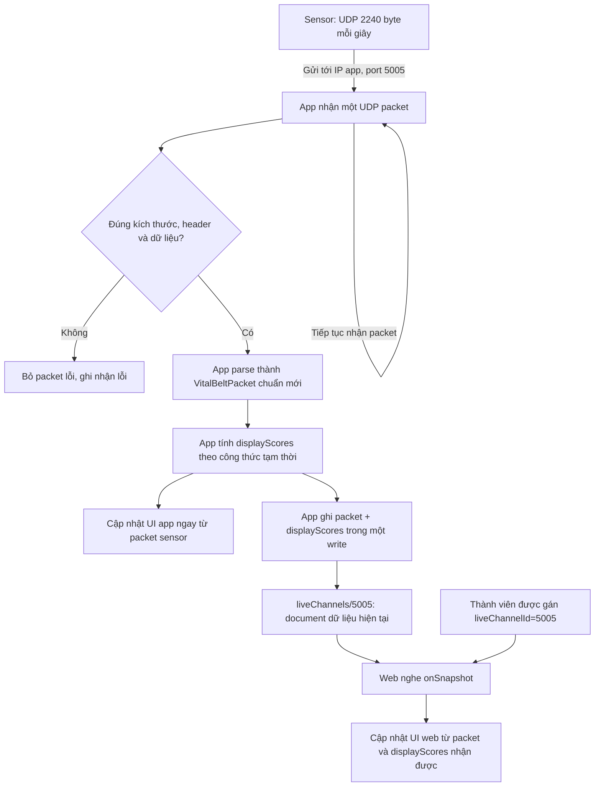

# Spec Vital Belt Sensor App Firestore Web cho port 5005

Spec 2026-10-09; cập nhật và gộp 2026-10-12: đầy đủ contract field UDP, cấu trúc Firestore và `displayScores` trong file này. App tính các chỉ số khách cung cấp và publish `displayScores` cùng packet. Web chỉ snapshot và hiển thị. Bảng mapping UI, miền giá trị, ví dụ JSON và listener cho các điểm tính sẵn nằm ở mục 4.3; không cần đọc file display-scores riêng.

**Luồng đã chốt: sensor gửi UDP → app nhận và hiển thị → app ghi Firestore → web nhận snapshot và hiển thị.** App là cầu nối lên Internet. Web hiển thị cùng dữ liệu sensor mà app gửi, với độ trễ truyền/ghi/nhận snapshot; không cố phát đồng thời bằng đồng hồ hai máy. Luồng này dùng được với nguồn demo gửi UDP và nguồn thiết bị thật cùng protocol.

Protocol theo `VitalBeltUDP出力フォーマット_taos_20260930.docx`: **một packet 2.240 byte mỗi giây**. Field tiếng Anh ưu tiên giữ tên source. Cột tiếng Nhật là tên đối chiếu với DOCX, không phải một bộ field API khác.

## 1. Flowchart



App cập nhật UI ngay khi packet hợp lệ, không chờ Firestore ghi xong. Firestore có thay đổi thực tế mỗi khi app ghi thành công; listener web nhận bản dữ liệu đó. Không có bước import dataset, tải toàn bộ bản ghi, phát vòng lặp hoặc ước lượng giờ server để chọn packet.

## 2. Port và điều kiện kết nối

- App mở UDP listener tại **port 5005**.
- Sensor được cấu hình remote host là **IP của app** và remote port là **5005**. Đường mạng sensor→app phải truyền được UDP, thường là cùng mạng LAN phù hợp.
- App cần Internet để ghi Firestore; web cần Internet để đọc Firestore. Web có thể ở mạng khác app.
- Firestore không tự nhận UDP và không mở socket 5005. `5005` trong đường dẫn Firestore là ID kênh ứng với port mà app đang nhận.
- Trong demo này, chỉ có một app được cấp quyền publish kênh 5005 tại một thời điểm. Hai app cùng ghi một document sẽ ghi đè nhau, nên không cho chạy hai publisher đồng thời.
- Web lấy `liveChannelId="5005"` từ cấu hình thành viên/thiết bị. Không yêu cầu thêm ô nhập port vào giao diện admin.
- Trong buổi demo, giữ app hoạt động và nhận UDP. Khi app bị đóng/dừng hoặc sensor ngừng gửi, dữ liệu mới trên web cũng dừng. Không mặc định ứng dụng vẫn chạy UDP/publish liên tục khi ở nền.

App làm cầu nối là điều kiện của luồng này. Việc dùng Firestore không loại bỏ yêu cầu app đang nhận được dữ liệu.

## 3. Quy định byte và tên field


Offset bắt đầu từ 0. Các khoảng byte bao gồm cả hai đầu. Tổng layout bắt buộc:

| Byte | Khối trong DOCX | Field tiếng Anh | Số byte | Kiểu / số mẫu |
|---|---|---|---:|---|
| 0–89 | ヘッダ+1秒間のバイタルデータ | `header`, `packetCounter`, `vital`, `reserved` | 90 | Bảng chi tiết bên dưới |
| 90–1089 | 1秒間のドップラセンサーデータの心拍成分 | `dopplerHeart` | 1000 | Float64 × 125 mẫu/giây |
| 1090–2089 | 1秒間のドップラセンサーデータの呼吸成分 | `dopplerBreath` | 1000 | Float64 × 125 mẫu/giây |
| 2090–2139 | 1秒間の３DセンサーX方向データ | `accelX` | 50 | Int16 × 25 mẫu/giây |
| 2140–2189 | 1秒間の３DセンサーY方向データ | `accelY` | 50 | Int16 × 25 mẫu/giây |
| 2190–2239 | 1秒間の３DセンサーZ方向データ | `accelZ` | 50 | Int16 × 25 mẫu/giây |
| 0–2239 | Tổng | — | **2240** | **90 + 1000 + 1000 + 50 + 50 + 50** |

`header`, `packetCounter`, `vital`, `reserved`, hai Doppler và ba gia tốc đều nằm ở root packet. Các field chỉ số nằm trong `vital`, đúng cách tổ chức của model hiện tại.

### 3.1 Bảng header và vitals đầy đủ

| Byte | Tên gốc DOCX | Field JSON | Đọc nhị phân → JSON | Ý nghĩa / đơn vị / giá trị đặc biệt | Tương thích source |
|---|---|---|---|---|---|
| 0–1 | ヘッダ | `header` | 2 Uint8 → number[] | Bắt buộc `[71, 81]` tương ứng `0x47 0x51`. | Mới trong JSON |
| 2–3 | シーケンス番号 (mô tả header trong DOCX) | `packetCounter` | Uint16 LE | 0..65535; sau 65535 quay về 0; không dùng làm thứ tự replay. | Giữ tên source |
| 4–7 | 時間 | `vital.epochSeconds` | Uint32 LE | Unix epoch giây do sensor ghi; phục vụ hiển thị thời gian nguồn. | Giữ tên source |
| 8 | 状態 | `vital.status` | Uint8 | 0=có người; 1=không có người; 2=cử động. | Giữ tên source |
| 9 | 心拍 | `vital.heartBeat` | Uint8 | BPM; 0=không đo được/không có người. | Giữ tên source |
| 10 | 呼吸 | `vital.breath` | Uint8 | RPM; 0=không đo được/không có người. | Giữ tên source |
| 11 | アラーム警報 | `vital.alarm` | Uint8 | Mã cảnh báo; DOCX ghi hiện chưa triển khai, đang xuất 0. | Giữ tên source |
| 12–13 | 歩数 | `vital.stepCounter` | Uint16 LE | Bước tích lũy kể từ bắt đầu đo; reset khi stop sensing. | Giữ tên source |
| 14–15 | WBGT×10 | `vital.wbgt` | Uint16 LE / 10 | JSON đã chia 10; không chia thêm lần nữa trên web. | Giữ tên source |
| 16–17 | 温度 | `vital.temperature` | Int16 LE / 10 | JSON là °C, đã chia 10; hỗ trợ nhiệt độ âm. | Giữ tên source |
| 18–19 | 湿度 | `vital.humidity` | Uint16 LE / 10 | JSON là %, đã chia 10; raw 0..1000. | Giữ tên source |
| 20–23 | 緯度 | `vital.latitude` | Float32 LE | Giữ giá trị gốc; hướng N/S lưu riêng. | Giữ tên source |
| 24–27 | 経度 | `vital.longitude` | Float32 LE | Giữ giá trị gốc; hướng E/W lưu riêng. | Giữ tên source |
| 28 | 緯度方向 | `vital.latitudeNS` | Uint8 → ASCII | Chuỗi N hoặc S. | Giữ tên source |
| 29 | 経度方向 | `vital.longitudeEW` | Uint8 → ASCII | Chuỗi E hoặc W. | Giữ tên source |
| 30–31 | 体動値 | `vital.bodyMoveIndex` | Uint16 LE | Giá trị cử động; không tự tính lại công thức. | Giữ tên source |
| 32 | 熱ストレス | `vital.heatStress` | Uint8 | 1..5; cao hơn=rủi ro nhiệt cao hơn. | Giữ tên source |
| 33–36 | リアプノフ指数 | `vital.lyapunovIndex` | Float32 LE | Chỉ số Lyapunov; không tự suy ra từ BPM. | Bổ sung model |
| 37–40 | 心拍ゆらぎLF/HF | `vital.lfHf` | Float32 LE | Tỷ lệ LF/HF. | Bổ sung model |
| 41–44 | DFA指数　ゆらぎ健康度 | `vital.dfaIndex` | Float32 LE | Chỉ số DFA. | Bổ sung model |
| 45–48 | 体動面積 | `vital.bodyMoveArea` | Float32 LE | Diện tích cử động. | Bổ sung model |
| 49 | 心拍数-５段階レベル | `vital.heartRateLevel` | Uint8 | 1..5; 5=rất tốt, 4=tốt, 3=bình thường, 2=lưu ý, 1=cần lưu ý. | Bổ sung model |
| 50 | 呼吸数-５段階レベル | `vital.respirationLevel` | Uint8 | 1..5; 5=rất tốt, 4=tốt, 3=bình thường, 2=lưu ý, 1=cần lưu ý. | Bổ sung model |
| 51 | 歩数-５段階レベル | `vital.stepLevel` | Uint8 | 1..5; 5=rất năng động, 4=tốt, 3=bình thường, 2=ít vận động, 1=rất ít vận động. | Bổ sung model |
| 52 | リアプノフ指数-５段階レベル | `vital.lyapunovLevel` | Uint8 | 1..5; cao hơn=linh hoạt/ổn định hơn. | Bổ sung model |
| 53 | 心拍ゆらぎLF/HF-６段階レベル | `vital.lfHfLevel` | Uint8 | 0..5; 0=thư giãn quá mức/giảm phản ứng, 1=stress mạnh, 2=stress cao, 3=bình thường, 4=tốt, 5=ổn định. | Bổ sung model |
| 54 | DFA指数　ゆらぎ健康度-５段階レベル | `vital.dfaLevel` | Uint8 | 1..5; cao hơn=tốt hơn. | Bổ sung model |
| 55 | 体動面積-５段階レベル | `vital.bodyMoveAreaLevel` | Uint8 | 1..5; cao hơn=ổn định hơn. | Bổ sung model |
| 56 | WBGT-５段階レベル | `vital.wbgtLevel` | Uint8 | 1..5; 1=nguy hiểm, 2=cảnh giác, 3=lưu ý, 4=tốt, 5=thoải mái. | Bổ sung model |
| 57–58 | 気圧 | `vital.pressure` | Uint16 LE | hPa; 0=chưa lấy được/không đo được. Giữ tên pressure đang có. | Giữ tên source |
| 59 | 姿勢判定 | `vital.posture` | Uint8 | 0=chưa xác định; 1=đứng; 2=nằm ngửa; 3=nằm sấp; 4=nghiêng trái; 5=nghiêng phải; 6=đảo ngược; 255=không xác định được. | Bổ sung model |
| 60 | 疲労度 | `vital.fatigue` | Uint8 | 0..100; cao hơn=mệt hơn; 255=không xác định. | Bổ sung model |
| 61 | 集中度 | `vital.concentration` | Uint8 | 0..100; cao hơn=tập trung hơn; 255=không xác định. | Bổ sung model |
| 62 | 眠気度 | `vital.drowsiness` | Uint8 | 0..100; cao hơn=buồn ngủ hơn; 255=không xác định. | Bổ sung model |
| 63 | ストレス度 | `vital.stress` | Uint8 | 0..100; cao hơn=căng thẳng hơn; 255=không xác định. | Bổ sung model |
| 64 | リラックス度 | `vital.relaxation` | Uint8 | 0..100; cao hơn=thư giãn hơn; 255=không xác định. | Bổ sung model |
| 65 | 総合コンディション | `vital.overall` | Uint8 | 0..100; cao hơn=trạng thái tốt hơn; 255=không xác định. Tên overall đang có trong HomeDemoData; mới đối với VitalData. | Bổ sung model |
| 66–89 | 拡張用のリザーブ | `reserved` | 24 Uint8 → number[] | Hiện xuất 24 số 0; không dùng làm metric. | Mới trong JSON |

Bảng này là danh sách field dữ liệu chuẩn, không đổi `heartBeat` thành `bpm`, `breath` thành `rpm`, `pressure` thành `pressureHpa`, hoặc `dopplerHeart` thành tên khác.

Little endian được DOCX ghi rõ cho counter, thời gian, các chỉ số Float32 và một số số nguyên. Với những phần DOCX chỉ ghi kiểu nhưng chưa ghi endian/signedness, spec tích hợp chốt Float64/Int16 little endian và số nguyên không âm Uint16 như parser source. Đây là quy ước tích hợp, không phải câu chữ bổ sung vào DOCX; đối chiếu lại khi nhận thiết bị thật.

### 3.2 Quy tắc giá trị

| Field | Quy định |
|---|---|
| `wbgt`, `temperature`, `humidity` | Firestore lưu giá trị đã chia 10, đúng model hiện có. Ví dụ nhiệt độ raw 280 lưu 28.0 °C. Web không chia 10 thêm lần nữa. |
| `pressure` | Số nguyên hPa, không chia 10. |
| `heartBeat`, `breath` | 0 nghĩa là không có kết quả đo; UI hiển thị `—`, không giả lập một phép đo nhịp 0. |
| `fatigue`, `concentration`, `drowsiness`, `stress`, `relaxation`, `overall` | Giữ nguyên 0..100 hoặc 255 trong document. UI đổi 255 thành `—`; 0 vẫn là score hợp lệ. |
| `posture` | Giữ code 0..6 hoặc 255. Không có mã “ngồi” trong DOCX. |
| `lfHfLevel` | 0 là mức hợp lệ của thang 6 mức; không tự coi là thiếu dữ liệu. |
| `heatStress` | 1..5; số lớn hơn=rủi ro cao hơn. |
| `wbgtLevel` | 1..5; số lớn hơn=tốt hơn. Không dùng chung cách đánh giá với heatStress. |
| Float32/Float64 | Chỉ công bố bộ demo có số hữu hạn. NaN/Infinity không đưa vào chart như điểm đo hợp lệ. |
| `reserved` | Đúng 24 số 0 trong phiên bản hiện tại. Không tạo metric từ các byte này. |

`addressDetail`, `windSpeed`, `currentHour`, `hourlyActivity`, `hourlyStep`, `hourlyDistance`, `weeklyHeartRate`, `secondHeartRate`, `secondRespiration` có trong source nhưng **không phải field packet của DOCX**. Không gán byte hay đưa vào contract packet này. Nếu UI cần lịch sử/địa chỉ thì xử lý riêng, không tuyên bố có trong packet.


## 4. Cấu trúc Firestore

```text
channelAccess/5005             # Cấu hình quyền, do bên quản trị chuẩn bị
liveChannels/5005              # Document dữ liệu mới nhất, app ghi và web đọc
members/{memberId}             # Cấu hình thành viên hiện có: liveChannelId="5005"
```

Kênh 5005 chỉ lưu **trạng thái/packet mới nhất**, được ghi đè khi có packet mới. Không tạo một document lịch sử mới mỗi giây, không lưu song song payload nhị phân và bản JSON đã parse. Spec này không yêu cầu lưu toàn bộ lịch sử để tải lại về sau.

### 4.1 Document liveChannels/5005

```ts
import type { Timestamp } from "firebase/firestore";

interface VitalData2240 {
  epochSeconds: number;
  status: number;
  heartBeat: number;
  breath: number;
  alarm: number;
  stepCounter: number;
  wbgt: number;
  temperature: number;
  humidity: number;
  latitude: number;
  longitude: number;
  latitudeNS: string;
  longitudeEW: string;
  bodyMoveIndex: number;
  heatStress: number;
  lyapunovIndex: number;
  lfHf: number;
  dfaIndex: number;
  bodyMoveArea: number;
  heartRateLevel: number;
  respirationLevel: number;
  stepLevel: number;
  lyapunovLevel: number;
  lfHfLevel: number;
  dfaLevel: number;
  bodyMoveAreaLevel: number;
  wbgtLevel: number;
  pressure: number;
  posture: number;
  fatigue: number;
  concentration: number;
  drowsiness: number;
  stress: number;
  relaxation: number;
  overall: number;
}

interface VitalBeltPacket2240 {
  header: number[];             // [71, 81]
  packetCounter: number;       // Counter sensor từ byte 2–3
  vital: VitalData2240;
  dopplerHeart: number[];       // 125 phần tử
  dopplerBreath: number[];      // 125 phần tử
  accelX: number[];             // 25 phần tử
  accelY: number[];             // 25 phần tử
  accelZ: number[];             // 25 phần tử
  reserved: number[];           // 24 số 0
}

interface LiveChannelDocument {
  meta: {
    sourcePort: 5005;
    protocolVersion: "taos-20260930";
    packetBytes: 2240;
    publisherUid: string;      // UID Firebase của app được phép ghi
    publisherSessionId: string; // ID mới khi bắt đầu một phiên nhận/publish
    sequence: number;          // Tăng theo packet nhận trong phiên; không wrap ở 65535
    publishedAt: Timestamp;    // App ghi bằng serverTimestamp()
  };
  packet: VitalBeltPacket2240;
  displayScores?: {
    formulaVersion: "client-temporary-20261011-v2";
    activityScore: number | null; // App caps raw activity at 100; web renders directly.
    bodyStatus: number | null;
    mindStatus: number | null;
    environmentRisk: number | null;
    mindMargin: number | null;
    comfortScore: number | null;
    discomfortScore: number | null;
  }; // Optional only for older app builds; the updated app always publishes it.
}
```

`displayScores` là các điểm app tính, không nằm trong packet nhị phân DOCX. Web hiển thị trực tiếp, không tự tính hoặc dùng số 0 thay null. Các field điểm luôn được ghi cùng `packet` trong một write; không giữ điểm cũ khi packet mới thiếu đầu vào. `meta` là thông tin tích hợp, không phải field DOCX. `packet` là dữ liệu chuẩn theo bảng byte. Giữ cấu trúc model root `packetCounter`, `vital`, `dopplerHeart`, `dopplerBreath`, `accelX/Y/Z`; web dùng `document.packet.vital.heartBeat` và app dùng `VitalBeltPacket.fromJson(document.packet)` sau khi cập nhật model đủ field mới.

`meta.sequence` bắt đầu từ 0 và tăng theo packet sensor hợp lệ trong mỗi publisherSessionId. Nó khác `packet.packetCounter` của sensor, vốn có thể reset/wrap. Một write có thể bỏ qua sequence trung gian nếu kết nối chậm và app ưu tiên gửi packet mới nhất.

**2.240 byte là kích thước UDP đầu vào.** Document Firestore chứa JSON đã parse và metadata nên kích thước khác 2.240 byte. Không lưu lại payload Bytes để tránh trùng lặp; app chịu trách nhiệm kiểm tra nhị phân trước khi publish.

Firestore có thể trả về số nguyên hoặc số thực cho một field số. Flutter cần chuyển field double bằng `(value as num).toDouble()`, bao gồm nhiệt độ/độ ẩm/WBGT, tọa độ, chỉ số Float32 và Doppler.

### 4.2 Cấu hình quyền channelAccess/5005

```ts
interface ChannelAccess {
  publisherUid: string;
  readerUids: string[];
}
```

Cấu hình quyền do người quản trị thiết lập qua công cụ có quyền quản trị Firebase. App/viewer không được tự sửa publisherUid hoặc tự thêm mình vào readerUids.

| Dữ liệu | App publisher | Web reader | Bên quản trị |
|---|---|---|---|
| channelAccess/5005 | Đọc nếu được gán | Đọc nếu được gán | Cấu hình quyền |
| liveChannels/5005 | Ghi đúng kênh được gán | Chỉ đọc | Quản lý theo quyền quản trị |
| members/{memberId}.liveChannelId | Theo quyền thành viên hiện có | Đọc theo quyền thành viên hiện có | Gán nguồn cho thành viên |

App và web cần Firebase Authentication identity để rules nhận biết UID. Đăng nhập HTTP hiện có không tự tạo Firebase UID; cần tích hợp identity Firebase cho cả hai bên. Anonymous Auth có thể dùng cho demo nếu UID được cấp quyền rõ ràng; không mở đọc/ghi public hoặc chỉ cần biết port là được ghi.

Rules phải kiểm tra đúng publisher UID, sourcePort=5005, protocolVersion, packetBytes=2240 và publishedAt là server timestamp. Mỗi kênh chỉ cho publisher được gán ghi. Phần đo giờ/probe theo uid của phương án phát lại đã được loại bỏ.

### 4.3 App-calculated display scores — web contract

Document: `liveChannels/5005` in project `vital-belt-demo-20261010`.

The app calculates all temporary customer scores. Web does not need the formulas, heat-level conversion, or activity normalization logic. Raw protocol fields keep their existing names under `packet`; calculated fields are separate under `displayScores`.

#### 4.3.1 UI mapping and display rules

| UI | Firestore field | Value |
|---|---|---|
| 活動量 / Activity | `displayScores.activityScore` | Integer 0–100 or null; raw values >=100 are capped at 100 |
| からだの状態 / Body status | `displayScores.bodyStatus` | Integer 0–100 or null |
| こころの状態 / Mind status | `displayScores.mindStatus` | Integer 0–100 or null |
| 環境リスク / Environment risk | `displayScores.environmentRisk` | Integer 0–100 or null |
| こころの余裕度 / Mental reserve | `displayScores.mindMargin` | Integer 40–80 or null; display on a /100 scale |
| 快適度 / Comfort | `displayScores.comfortScore` | Integer 0–100 or null |
| 不快度 / Discomfort | `displayScores.discomfortScore` | Integer 0–100 or null |
| Formula identifier | `displayScores.formulaVersion` | `client-temporary-20261011-v2`; informational only |

The customer supplied six calculated/display mappings; all six are included. Display 0 as a real score. Display null as `—`, clear any previous value, and do not calculate a fallback. A missing displayScores object from an older app also displays `—` for these fields.

All scores in one snapshot correspond to the same packet and `meta.sequence`. App retries/network coalescing keep the raw packet and calculated scores together. Use the existing publisherSessionId/sequence ordering; do not perform separate reads for scores.

Activity update (2026-10-11): app caps raw bodyMoveIndex at 100 before display and body calculation, as requested by the user. Web displays displayScores.activityScore directly; it does not need to cap values. Raw packet.vital.bodyMoveIndex is preserved. A raw movement value of 255 is valid UInt16 data and caps to 100; only the separate byte-sized fatigue/stress/etc. scores use 255 as an unknown sentinel. Body status is calculated when fatigue is valid; missing fatigue still yields null.

Raw heat danger stays at `packet.vital.heatStress`, level 1–5. The environment aggregate is already calculated as `displayScores.environmentRisk`, 0–100. Overall condition remains `packet.vital.overall`; it is not replaced by these calculated scores.

#### 4.3.2 Example payload

Values calculated from one illustrative packet, not a screenshot of production:

```json
{
  "displayScores": {
    "formulaVersion": "client-temporary-20261011-v2",
    "activityScore": 60,
    "bodyStatus": 68,
    "mindStatus": 80,
    "environmentRisk": 38,
    "mindMargin": 72,
    "comfortScore": 80,
    "discomfortScore": 20
  }
}
```

#### 4.3.3 Render the scores from the existing snapshot

After Firebase authentication and reader authorization, render these scores from the same snapshot used for vitals and charts. The minimal fragment below illustrates score binding; integrate it into the listener in section 7.1 rather than creating a second listener. Keep the metadata/cache/stale and session/sequence checks from that section:

```javascript
import { doc, onSnapshot } from "firebase/firestore";

const displayScore = value => value == null ? "—" : String(value);
const unsubscribe = onSnapshot(doc(db, "liveChannels", "5005"), snapshot => {
  if (!snapshot.exists()) return;
  const { meta, packet, displayScores } = snapshot.data();
  // Apply the existing cache/stale and session/sequence handling here.
  // renderScores is your UI binding, not a Firebase API.
  renderScores({
    activityScore: displayScore(displayScores?.activityScore),
    bodyStatus: displayScore(displayScores?.bodyStatus),
    mindStatus: displayScore(displayScores?.mindStatus),
    environmentRisk: displayScore(displayScores?.environmentRisk),
    mindMargin: displayScore(displayScores?.mindMargin),
    comfortScore: displayScore(displayScores?.comfortScore),
    discomfortScore: displayScore(displayScores?.discomfortScore)
  });
  // Keep consuming meta and packet for the existing vitals/charts.
});
```

This remains one latest document per channel; no Cloud Functions or extra history collection is required.

#### 4.3.4 Verification recorded on 2026-10-11

These are previously recorded implementation checks, not new test runs performed when merging this document.

Initial verification (before the activity cap): 40 app tests passed (one external-capture UDP test skipped), analyzer clean, iOS simulator build passed, and Firestore rules passed emulator tests and were deployed. The updated simulator app published `displayScores` to the production document. An observed snapshot at sequence 17 / sensor packetCounter 329 had bodyStatus=null, mindStatus=75, environmentRisk=22, mindMargin=73, comfortScore=84, discomfortScore=18. These values were independently checked against that snapshot’s raw inputs and matched the customer formulas.

Activity-cap verification: updated simulator Home displays activity 100. A production snapshot with raw bodyMoveIndex=354, fatigue=20 published activityScore=100, bodyStatus=92 under client-temporary-20261011-v2. 42 app tests passed; analyzer, iOS build, emulator rule checks and production rule deployment succeeded.

## 5. Parser tham chiếu cho protocol mới

App triển khai parser Flutter tương đương hàm JavaScript tham chiếu dưới đây. Web đọc JSON do app publish, không cần giải mã lại tất cả byte mỗi lần nhận snapshot.

```js
function decodeVitalBelt2240(bytes) {
  if (!(bytes instanceof Uint8Array) || bytes.byteLength !== 2240) {
    throw new Error("INVALID_PACKET_BYTES");
  }
  if (bytes[0] !== 0x47 || bytes[1] !== 0x51) {
    throw new Error("INVALID_PACKET_HEADER");
  }
  const v = new DataView(bytes.buffer, bytes.byteOffset, bytes.byteLength);
  return {
    header: [v.getUint8(0), v.getUint8(1)],
    packetCounter: v.getUint16(2, true),
    vital: {
      epochSeconds: v.getUint32(4, true),
      status: v.getUint8(8),
      heartBeat: v.getUint8(9),
      breath: v.getUint8(10),
      alarm: v.getUint8(11),
      stepCounter: v.getUint16(12, true),
      wbgt: v.getUint16(14, true) / 10,
      temperature: v.getInt16(16, true) / 10,
      humidity: v.getUint16(18, true) / 10,
      latitude: v.getFloat32(20, true),
      longitude: v.getFloat32(24, true),
      latitudeNS: String.fromCharCode(v.getUint8(28)),
      longitudeEW: String.fromCharCode(v.getUint8(29)),
      bodyMoveIndex: v.getUint16(30, true),
      heatStress: v.getUint8(32),
      lyapunovIndex: v.getFloat32(33, true),
      lfHf: v.getFloat32(37, true),
      dfaIndex: v.getFloat32(41, true),
      bodyMoveArea: v.getFloat32(45, true),
      heartRateLevel: v.getUint8(49),
      respirationLevel: v.getUint8(50),
      stepLevel: v.getUint8(51),
      lyapunovLevel: v.getUint8(52),
      lfHfLevel: v.getUint8(53),
      dfaLevel: v.getUint8(54),
      bodyMoveAreaLevel: v.getUint8(55),
      wbgtLevel: v.getUint8(56),
      pressure: v.getUint16(57, true),
      posture: v.getUint8(59),
      fatigue: v.getUint8(60),
      concentration: v.getUint8(61),
      drowsiness: v.getUint8(62),
      stress: v.getUint8(63),
      relaxation: v.getUint8(64),
      overall: v.getUint8(65),
    },
    dopplerHeart: Array.from({ length: 125 }, (_, i) => v.getFloat64(90 + i * 8, true)),
    dopplerBreath: Array.from({ length: 125 }, (_, i) => v.getFloat64(1090 + i * 8, true)),
    accelX: Array.from({ length: 25 }, (_, i) => v.getInt16(2090 + i * 2, true)),
    accelY: Array.from({ length: 25 }, (_, i) => v.getInt16(2140 + i * 2, true)),
    accelZ: Array.from({ length: 25 }, (_, i) => v.getInt16(2190 + i * 2, true)),
    reserved: Array.from({ length: 24 }, (_, i) => v.getUint8(66 + i)),
  };
}

```

App còn phải validate miền giá trị, số hữu hạn, số mẫu và reserved trước publish. Giữ sentinel trong dữ liệu, xử lý hiển thị theo mục 3.2. Không tự suy ra score/level mà tài liệu không cung cấp công thức.

## 6. Luồng app nhận và publish

| Thứ tự | Hành vi |
|---|---|
| 1 | Xác nhận Firebase UID của app được cấp quyền publish kênh 5005. |
| 2 | Mở UDP listener port 5005; sensor gửi tới IP app. |
| 3 | Với mỗi UDP datagram, kiểm tra đúng 2240 byte và header 47 51. Không ghép các datagram độc lập để tạo packet hợp lệ giả. |
| 4 | Parse theo layout mới, kiểm tra dữ liệu và cập nhật UI app ngay. |
| 5 | Tăng sequence của phiên, tạo document với packet, meta và displayScores của cùng packet; ghi đè liveChannels/5005 bằng một write đầy đủ, publishedAt=serverTimestamp(). |
| 6 | Chờ xác nhận publish, tiếp tục nhận sensor và nhận packet mới cho UI độc lập với tốc độ mạng. |

Nguyên tắc publisher:

- Với tốc độ chuẩn một packet/giây, tối đa một write/packet gửi lên document hiện tại.
- Không dùng merge để giữ lại field packet cũ khi packet mới thiếu field; packet thiếu là lỗi validate.
- Chỉ một write đang xử lý và một vị trí chờ chứa **packet mới nhất**. Không xây hàng đợi vô hạn khi mạng chậm. Packet mới thay vị trí chờ cũ; app vẫn hiển thị tất cả packet hợp lệ nó nhận được.
- Khi offline/reconnect, ưu tiên trạng thái mới nhất; không gửi lại toàn bộ bản ghi cũ để giả làm dữ liệu live. Firebase SDK có thể giữ một write đang chờ trong cơ chế offline; cần xử lý/kiểm thử tình huống đó, không coi mọi commit vừa đến là phép đo vừa được lấy.
- Khi restart phiên hoặc thay publisher, không để callback/write cũ lẫn vào phiên mới. Chỉ một publisher hoạt động, kiểm tra session/sequence và vòng đời publisher.
- Packet lỗi không thay thế packet hợp lệ đang hiển thị. Ghi nhận lỗi nguồn; không tiếp tục random dữ liệu để che việc sensor dừng.

Việc lưu mọi packet phục vụ lịch sử không nằm trong luồng document current này. Nếu yêu cầu lưu lịch sử được bổ sung, thiết kế đường lưu riêng và kiểm tra chi phí; không làm web tải toàn bộ lịch sử trước khi xem live.

## 7. Luồng web nhận snapshot

### 7.1 Khi mở thành viên

1. Đọc cấu hình thành viên đã được cấp quyền, lấy liveChannelId=5005.
2. Xác nhận Firebase UID của web nằm trong quyền đọc kênh.
3. Đăng ký listener document `liveChannels/5005`.
4. Snapshot ban đầu cho biết packet cuối cùng đang lưu. Nếu chưa có document, hiển thị “Chưa có dữ liệu sensor”. Nếu là cache, đánh dấu dữ liệu đã lưu/chưa xác nhận kết nối.
5. Với snapshot server hợp lệ, kiểm tra metadata, các field bắt buộc và số phần tử mảng, rồi hiển thị dữ liệu nguồn.
6. Snapshot tiếp theo có sequence mới sẽ cập nhật UI web. Không tải N packet, không dựng một lịch phát từ startedAt.

```js
import { doc, onSnapshot } from "firebase/firestore";

const unsubscribe = onSnapshot(
  doc(db, "liveChannels", "5005"),
  { includeMetadataChanges: true },
  (snapshot) => {
    if (!snapshot.exists()) {
      showNoSensorData();
      return;
    }
    if (snapshot.metadata.fromCache || snapshot.metadata.hasPendingWrites) {
      showCachedOrUnconfirmedData(snapshot.data());
      return;
    }
    const current = snapshot.data();
    // Các hàm dưới đây là trách nhiệm triển khai của reader/view model.
    // Validate theo interface và bảng field; lọc session/sequence đã xử lý.
    if (!validateLiveChannel(current)) {
      showInvalidSensorData();
      return;
    }
    if (!acceptSessionAndSequence(current.meta)) return;
    renderLatestPacket(current.packet, current.meta, current.displayScores);
  },
  () => showConnectionOrPermissionError()
);

// Khi đóng/đổi thành viên: unsubscribe(); dừng timer/chart của nguồn cũ.
```

Các helper trong ví dụ là pseudocode cần triển khai, không phải API Firebase. Bật metadata changes để phân biệt cache/đã xác nhận; chỉ metadata đổi không được append lại cùng packet vào biểu đồ.

### 7.2 Thứ tự và mất packet

- Cùng publisherSessionId: chỉ xử lý sequence lớn hơn sequence đã nhận; trùng sequence bỏ qua phần append dữ liệu.
- PublisherSessionId đổi: xác nhận bản server, reset history nguồn trước khi nhận phiên mới. Bản cache không được đảo ngược session hiện tại.
- Counter sensor wrap không làm reset chart, vì thứ tự sử dụng meta.sequence và session.
- Nếu sequence nhảy, đánh dấu khoảng thiếu hoặc ngắt đoạn sóng; không giả tạo số mẫu chưa nhận được.
- **Document current không bảo đảm web nhận/lưu mọi packet sensor.** Khi web offline, mở muộn hoặc publisher gộp packet chờ, web lấy trạng thái mới nhất. Luồng này ưu tiên trạng thái hiện tại để demo realtime; chưa có cơ chế truy hồi lịch sử bị bỏ qua.

### 7.3 Trạng thái dữ liệu

| Tình huống | UI web |
|---|---|
| Chưa có document | Chưa có dữ liệu sensor. |
| Snapshot ban đầu hoặc cache | Hiển thị bản ghi cuối cùng với trạng thái đang chờ dữ liệu mới; không mặc định publisher còn hoạt động. |
| Có sequence mới từ server sau khi kết nối | Cập nhật dữ liệu, ghi mốc nhận bằng đồng hồ đơn điệu của web. |
| Không có sequence mới trong khoảng chờ | Giữ dữ liệu cuối cùng, đánh dấu không cập nhật/đã cũ; không tiếp tục tạo dữ liệu giả. |
| Thiếu quyền/mất mạng | Báo lỗi quyền hoặc kết nối; giữ nhãn dữ liệu cuối cùng nếu còn hiển thị. |

Khoảng chờ demo đề xuất là 5 giây cho nguồn 1 packet/giây; đây là quy ước tích hợp cần kiểm thử, không phải ngưỡng do DOCX/thiết kế quy định. Mốc nhận snapshot chỉ cho biết web vừa nhận cập nhật, không chứng minh phép đo được lấy ngay tại thời điểm đó.

Web bị trễ so với app do đường truyền và Firestore. Không đặt một thời gian trễ cố định như 1 giây rồi giả định luôn đúng. App hiển thị từ sensor, web hiển thị bản thực sự nhận được.

### 7.4 Biểu đồ và thời gian

- App và web dùng cùng field/tín hiệu. Chart xu hướng BPM/RPM dùng heartBeat/breath; chart Doppler dùng các mảng Doppler. Không tự đổi một loại chart thành loại khác.
- Web giữ buffer ngắn cho những packet đã nhận, vẽ mượt tại client. Mở web muộn thì buffer hình thành từ dữ liệu nhận sau đó; không tải nguyên dataset lịch sử.
- Nhận packet mới nối đúng sequence; thiếu packet cần biểu diễn gap. Không lặp mãi một packet/sóng cũ khi nguồn đã dừng.
- `vital.epochSeconds` là thời gian sensor ghi theo Unix epoch giây. `meta.publishedAt` là thời điểm Firestore commit theo Timestamp. Không trộn hai mốc hoặc dùng publishedAt để khẳng định tuổi thực của phép đo.
- UTC+7 và UTC+9 không đổi giá trị Unix timestamp của cùng một thời điểm. Chỉ định dạng giờ địa phương trên UI; không cộng/trừ múi giờ vào dữ liệu.
- Thứ tự dữ liệu theo session/sequence, không theo Date.now của mỗi máy. Không cần clock probe hoặc đồng hồ phát chung vì web không tự chọn packet từ bản ghi.
- Đo timeout/animation bằng đồng hồ đơn điệu: performance.now trên web, Stopwatch trên Flutter. Khi cần hiển thị timestamp, web dùng toMillis và Flutter dùng millisecondsSinceEpoch; epochSeconds nhân 1000 khi đổi sang mili giây.

## 8. Những điểm cần thống nhất trước khi bind UI

| Điểm | Quy định |
|---|---|
| GPS | DOCX chưa xác định độ thập phân hay độ/phút và quy tắc dấu. Giữ raw cùng N/S/E/W; xác nhận encoding trước khi đặt pin. Không suy luận NMEA chỉ từ field hướng. |
| Posture | Ánh xạ đúng code DOCX; không có ngồi. Nằm/đảo ngược không tự biến thành cảnh báo ngã khi chưa có quy tắc được xác nhận. |
| Heat risk | Chi tiết dùng packet.vital.heatStress thang 1–5; điểm nhóm môi trường dùng displayScores.environmentRisk thang 0–100. Web không tự chuyển đổi hoặc tính lại. |
| No data | Rate=0, pressure=0, score=255 và posture không xác định được hiển thị theo quy định. status=1/2 cần label riêng, không đánh đồng trạng thái sensor với lỗi mạng. |
| UI-only data | Không đưa lịch sử nhiều ngày/tuần hoặc score nhóm chưa có công thức vào packet dưới danh nghĩa kết quả sensor. |

Lớp nhận/publish bên app và lớp listener bên web phải tách khỏi widget/component UI. UI nhận cùng model đã chuẩn hóa; thay nguồn UDP demo bằng thiết bị thật cùng protocol không yêu cầu sửa cấu trúc màn hình.

## 9. Chi phí và phạm vi lưu trữ

Với một sensor 1 packet/giây và một web đang nghe, dự kiến một write document hiện tại mỗi giây và một read cho mỗi cập nhật document mà web nhận; một giờ liên tục tương ứng khoảng 3.600 writes và 3.600 reads. Đây là ước tính cơ bản, chưa tính snapshot ban đầu, reconnect, truy vấn quyền hoặc đọc phục vụ Security Rules. Nhiều viewer tăng lượt đọc. Khi nguồn dừng thì không tự tiếp tục ghi.

Firestore chỉ giữ packet mới nhất trong luồng này, nên mở web không cần tải 600/3.600/86.400 document trước khi xem. Chi phí phát sinh theo thời gian cập nhật thực tế, không theo độ dài một dataset tải nguyên bộ.

## 10. Phân công và nghiệm thu

| Bên | Việc cần triển khai |
|---|---|
| App | UDP 5005, parser/model đủ layout mới, UI từ sensor, Firebase identity, publisher một write hiện tại, xử lý vòng đời/mạng chậm. |
| Web | Mapping thành viên→kênh, Firebase identity và quyền đọc, snapshot reader, view model, buffer chart và trạng thái dữ liệu cũ/lỗi. |
| Cấu hình Firebase | Gán publisher/reader, rules cho từng kênh, kiểm tra quota khi demo kéo dài; không deploy Cloud Function. |

| Kiểm tra | Kết quả cần đạt |
|---|---|
| Sensor gửi packet hợp lệ tới app:5005 | App hiển thị trực tiếp, Firestore cập nhật document, web nhận cùng dữ liệu sau đó. |
| Payload sai byte/header/trường | App không publish như packet hợp lệ. |
| Field mới và cũ | Tên English khớp bảng DOCX và model, có đủ byte 33–65 và các mảng. |
| Rate sensor thay đổi | App/web nhận rate thật; không lấy HomeDemoData random thay thế. |
| Web mở sau | Nhận document hiện tại; không tải toàn bộ lịch sử. |
| UTC+7/UTC+9 hoặc giờ máy khác nhau | Không chọn packet theo giờ máy; xử lý session/sequence đúng. |
| Sensor/app dừng | Web giữ dữ liệu cuối cùng và báo không cập nhật sau khoảng chờ. |
| App nhận sensor nhưng mất Internet | App vẫn hiển thị local; web không có dữ liệu mới và báo đúng trạng thái. |
| Reconnect/mạng chậm | Không flush hàng đợi vô hạn; ưu tiên mới nhất; dữ liệu/phiên cũ không lẫn vào phiên mới. |
| Sequence gap / sensor counter wrap | Không giả tạo mẫu thiếu; không reset sai do counter wrap. |
| Unauthorized reader/publisher | Rules từ chối; viewer không được ghi vào kênh. |
| App vào nền/đóng | Kiểm thử trên device; không tuyên bố vẫn streaming khi app không nhận/publish được. |

Phần displayScores được triển khai trong app ngày 2026-10-11. Web tích hợp theo contract field; không cần các công thức khách gửi. Kiểm tra snapshot có displayScores trước khi tuyên bố app mới đã publish thành công.

## 11. Nguồn đối chiếu

- DOCX người dùng cung cấp: `VitalBeltUDP出力フォーマット_taos_20260930.docx`, TAOS 2026/09/30.
- Source tên field: `lib/src/core/model/vital_belt_packet.dart`, `lib/src/core/model/vital_data.dart`.
- [Firestore realtime listeners](https://firebase.google.com/docs/firestore/query-data/listen): snapshot ban đầu và cập nhật khi document đổi.
- [Firestore server timestamp](https://firebase.google.com/docs/firestore/manage-data/add-data#server_timestamp): thời điểm server ghi document.
- [Firestore billing](https://firebase.google.com/docs/firestore/pricing): reads/writes, listener và Security Rules.
- [Firestore authentication rules](https://firebase.google.com/docs/firestore/security/rules-conditions): quyền theo Firebase UID.
- [Firestore Timestamp](https://firebase.google.com/docs/reference/js/firestore.timestamp): thời điểm tuyệt đối độc lập múi giờ.
